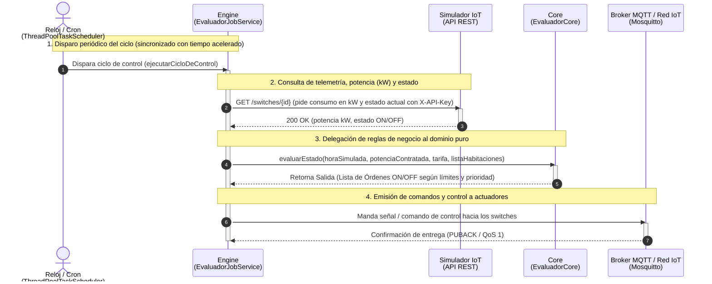

# Modelo de Arquitectura 4+1: EcoWarm (Iteración 5)

Este documento describe la arquitectura del sistema **EcoWarm** utilizando el modelo de vistas **4+1** de Philippe Kruchten. Refleja las decisiones de diseño adoptadas hasta la **Iteración 5**, incluyendo la separación multi-módulo, el ciclo de control periódico con soporte de tiempo acelerado, las métricas de calidad y cobertura de código (JaCoCo), y la infraestructura contenerizada con Docker.

---

## 1. Vista Lógica

La arquitectura del sistema responde a un enfoque desacoplado y multi-módulo, aislando completamente las reglas de negocio puras de las responsabilidades de infraestructura (frameworks, bases de datos y protocolos de comunicación).

El sistema se divide en dos grandes módulos independientes:

### A. Módulo `core` (El Dominio Puro)
* **Responsabilidad:** Contiene la lógica matemática, las reglas tarifarias y las decisiones de encendido/apagado (`EvaluadorCore`).
* **Características:**
  * Biblioteca en Java 25 puro (Plain Old Java Objects - POJOs y Records).
  * No posee dependencias de Spring Boot, MQTT, bases de datos ni clientes HTTP.
  * Representa el estado del sistema mediante objetos de transferencia inmutables (`HabitacionDTO`, `TarifaPunta`, `Orden`, `Salida`, etc.).
  * Altamente testeable mediante Desarrollo Guiado por Pruebas (TDD) utilizando JUnit 5 y Mockito.

### B. Módulo `engine` (La Infraestructura / Adaptadores)
* **Responsabilidad:** Actúa como el puente entre el mundo exterior (sensores, actuadores, simulador y base de datos) y el cerebro del sistema (`core`).
* **Características:**
  * Desarrollado sobre el framework Spring Boot (Web MVC y Spring Data JPA).
  * Maneja la persistencia relacional con PostgreSQL vía Spring Data JPA / JDBC.
  * Se suscribe asíncronamente a los tópicos de Mosquitto MQTT (`MqttSubscriberService`) para registrar lecturas físicas de temperatura.
  * Expone una API REST segura con validación de cabecera `X-API-Key` (`ApiKeyFilter`).
  * Se comunica como cliente HTTP REST hacia el Simulador para registro de controladores, telemetría y control de relés/switches.
  * Administra el temporizador periódico que orquesta el ciclo de control (`EvaluadorJobService`).

---

## 2. Vista de Procesos

La Vista de Procesos describe los aspectos dinámicos del sistema: la concurrencia, los hilos de ejecución, la sincronización en tiempo real y el ciclo de control automatizado.

### 2.1. Explicación del Ciclo de Control
El sistema opera en un ciclo de control cerrado periódico gestionado por el servicio `EvaluadorJobService`:

1. **Activación del Reloj / Cron:**
   * Un planificador de tareas (`ThreadPoolTaskScheduler`) ejecuta periódicamente el método `ejecutarCicloDeControl()`.
   * **Soporte de Tiempo Acelerado:** El intervalo de ejecución se ajusta dinámicamente según el factor de aceleración recibido desde el simulador (`intervalo = 30000 / factorAceleracion` ms, con límite mínimo de seguridad de 500 ms). Asimismo, se calcula un reloj simulado (`obtenerRelojSimulado()`) para evaluar los horarios punta sincronizados con el simulador.
2. **Recolección de Estado y Telemetría (Engine -> Base de Datos & Simulador):**
   * El `Engine` consulta a PostgreSQL los parámetros configurados del sitio: potencia contratada máxima en kW y franjas horarias de tarifa punta.
   * Obtiene la lista de habitaciones con sus temperaturas esperadas y las últimas temperaturas registradas por los sensores (con política de seguridad: si un termostato no reporta datos dentro de los últimos 10 minutos simulados, se asigna una temperatura crítica de 99.0 °C para forzar su apagado preventivo).
   * Consulta al **Simulador** vía HTTP GET (`/switches/{idSwitch}`) con autenticación `X-API-Key` para conocer el consumo en kW y el estado físico actual de cada switch.
3. **Evaluación de Reglas de Negocio (Engine -> Core):**
   * El `Engine` consolida la información en DTOs inmutables (`List<HabitacionDTO>`, `TarifaPunta`, potencia contratada y hora simulada) y llama a `EvaluadorCore.evaluarEstado(...)`.
   * El `Core` procesa el balance eléctrico: prioriza las habitaciones según su urgencia térmica, verifica que no se sobrepase la potencia contratada contratada (kW), aplica restricciones durante horas punta y emite un conjunto de decisiones deterministas (`Salida` conteniendo una lista de `Orden` con acciones `ON` u `OFF`).
4. **Envío de Señales y Comandos (Engine -> MQTT / Actuadores):**
   * El `Engine` itera sobre las órdenes devueltas por el `Core` y despacha las señales de comando hacia el broker MQTT y hacia los actuadores/switches correspondientes (`SwitchClientService`), completando el ciclo de control.
   * Todo el proceso cuenta con aislamiento de fallos: si un comando individual falla, el error es capturado y el ciclo continúa procesando el resto de las habitaciones sin colapsar.

### 2.2. Diagrama de Secuencia: Ciclo de Control
A continuación se modela la secuencia interactiva del ciclo de control:



---

## 3. Vista de Desarrollo

La Vista de Desarrollo ilustra la organización estática del código fuente, la modularidad de Maven, la gestión de dependencias y el ecosistema de aseguramiento de calidad y cobertura de pruebas.

### 3.1. Estructura Multi-Módulo con Apache Maven
El proyecto está estructurado como un proyecto Maven multi-módulo jerárquico:

* **POM Raíz (`/pom.xml`):**
  * Define la agregación de módulos (`<modules><module>modules/core</module><module>modules/engine</module></modules>`).
  * Estandariza la versión de Java a nivel global (Java 25).
  * Centraliza las versiones de dependencias en `<dependencyManagement>` (Spring Boot 3.5.14 BOM, Eclipse Paho MQTT 1.2.5, PostgreSQL Driver 42.7.2, Jackson 2.18.10, JUnit 5.11.0, Mockito 5.14.0).
  * Centraliza la configuración de plugins de calidad y compilación en `<pluginManagement>`: `maven-surefire-plugin`, `jacoco-maven-plugin` (0.8.15) y `maven-checkstyle-plugin` (3.6.0).
* **Módulo `modules/core`:**
  * Biblioteca Java estándar (JAR) sin frameworks externos.
  * Contiene los paquetes:
    * `com.ioteste.core.domain`: Clases inmutables de dominio (`HabitacionDTO`, `TarifaPunta`, `Orden`, `Salida`, `EstadoSwitch`, `AccionSwitch`).
    * `com.ioteste.core.service`: Lógica de decisión algorítmica (`EvaluadorCore`).
  * Su suite de pruebas unitarias (`src/test/java`) aplica TDD con JUnit 5 y Mockito.
* **Módulo `modules/engine`:**
  * Aplicación Spring Boot ejecutable (`jar` empaquetado con `spring-boot-maven-plugin`).
  * Declara una dependencia explícita hacia el módulo `core`:
    ```xml
    <dependency>
        <groupId>com.ioteste</groupId>
        <artifactId>core</artifactId>
        <version>${project.version}</version>
    </dependency>
    ```
  * Contiene los adaptadores de entrada y salida: controladores REST (`com.ioteste.engine.controller`), servicios de integración y background jobs (`com.ioteste.engine.service`), repositorios Spring Data JPA (`com.ioteste.engine.repository`), seguridad (`com.ioteste.engine.security`) y entidades de persistencia (`com.ioteste.engine.domain`).

### 3.2. Aseguramiento de Calidad y Reportes JaCoCo
Para garantizar la fiabilidad del núcleo algorítmico, el módulo `core` tiene integrado el plugin **JaCoCo** (`jacoco-maven-plugin`):
* **Fases automatizadas en el build:**
  1. `prepare-agent`: Instrumenta el bytecode para registrar las instrucciones ejecutadas durante los tests unitarios.
  2. `report`: Genera los reportes interactivos de cobertura en formato HTML, XML y CSV en `modules/core/target/site/jacoco/`.
  3. `check`: Aplica una regla estricta de validación que falla la compilación (`BUILD FAILURE`) si la cobertura de instrucciones del bundle desciende del umbral mínimo del **85%** (`COVEREDRATIO >= 0.85`).
* **Evidencias versionadas:** Los reportes generados se encuentran versionados en el repositorio en `/docs/calidad/cobertura/index.html`.
* **Estándares de Codificación:** El plugin `maven-checkstyle-plugin` evalúa las reglas de estilo de Google (`google_checks.xml`) en la fase `validate`.

### 3.3. Diagrama de Paquetes y Módulos
El siguiente diagrama detalla la descomposición en módulos Maven, paquetes internos y la generación de reportes de calidad:

```mermaid
flowchart TD
    subgraph RootProject["Proyecto Maven Multi-Módulo (ioteste-domotica)"]
        direction TB

        subgraph CoreModule["Módulo: modules/core (Dominio Puro - JAR)"]
            direction TB
            pkgCoreDomain["com.ioteste.core.domain<br/>• HabitacionDTO<br/>• TarifaPunta<br/>• Orden / Salida<br/>• EstadoSwitch / AccionSwitch"]
            pkgCoreService["com.ioteste.core.service<br/>• EvaluadorCore"]
            pkgCoreTests["src/test/java (Tests Unitarios TDD)<br/>• JUnit 5 & Mockito"]

            pkgCoreService --> pkgCoreDomain
            pkgCoreTests -.->|Ejecuta pruebas sobre| pkgCoreService
        end

        subgraph EngineModule["Módulo: modules/engine (Infraestructura / Spring Boot JAR)"]
            direction TB
            pkgEngineCtrl["com.ioteste.engine.controller<br/>• SitioController<br/>• ControlController"]
            pkgEngineSvc["com.ioteste.engine.service<br/>• EvaluadorJobService<br/>• MqttSubscriberService<br/>• SwitchClientService<br/>• SimuladorRegistroService"]
            pkgEngineRepo["com.ioteste.engine.repository / domain<br/>• SitioRepository<br/>• Entidades JPA y DTOs"]
            pkgEngineSec["com.ioteste.engine.security<br/>• ApiKeyFilter"]

            pkgEngineCtrl --> pkgEngineSvc
            pkgEngineSvc --> pkgEngineRepo
            pkgEngineSvc --> pkgEngineSec
        end

        EngineModule ==>|Dependencia Maven:<br/>com.ioteste:core| CoreModule
    end

    subgraph QualityAssurance["Reportes y Calidad de Código"]
        JaCoCoOutput["Reporte de Cobertura JaCoCo<br/>(docs/calidad/cobertura/index.html)<br/>• Regla: Cobertura &ge; 85%"]
        CheckstyleOutput["Reporte Checkstyle<br/>(docs/calidad/estandares_de_codificacion.md)<br/>• Reglas: google_checks.xml"]
    end

    CoreModule -.->|jacoco-maven-plugin<br/>(fase test & check)| JaCoCoOutput
    CoreModule -.->|maven-checkstyle-plugin<br/>(fase validate)| CheckstyleOutput
```

---

## 4. Vista Física (Despliegue)

La Vista Física modela la infraestructura de ejecución, los nodos de cómputo, los contenedores Docker y la gestión segura de configuración mediante variables de entorno.

### 4.1. Explicación de la Infraestructura
La solución está completamente contenerizada y orquestada mediante **Docker Compose** (`docker/docker-compose.yml`), asegurando portabilidad, aislamiento y reproducibilidad:

1. **Nodo Contenedor Engine (`ecowarm_engine`):**
   * Contenedor construido a partir de `modules/engine/Dockerfile` sobre una imagen base de Java 25.
   * Ejecuta el servicio backend Spring Boot, exponiendo el puerto `8080:8080` hacia el host para atender peticiones REST.
   * Gestiona las conexiones salientes hacia PostgreSQL, el Simulador y el Broker MQTT.
   * Condicionado por política de arranque: inicia únicamente cuando el nodo de base de datos ha alcanzado un estado saludable (`condition: service_healthy`).
2. **Nodo Contenedor Base de Datos (`iot_postgres_db`):**
   * Basado en la imagen oficial `postgres:15-alpine`.
   * Expone el puerto `5432:5432` hacia el host para administración e inspección.
   * Almacena de manera persistente las tablas de sitios, habitaciones e histórico de telemetría mediante el volumen Docker `ecowarm_data`.
   * Ejecuta el script de inicialización de esquema y datos `./init.sql` (`/docker-entrypoint-initdb.d/init.sql`).
   * Posee un mecanismo de verificación de salud (`healthcheck`) ejecutando `pg_isready -U ${DB_USER} -d ${DB_NAME}` con intervalos de 10 segundos.
3. **Nodo Archivo `.env` (Gestión Centralizada de Credenciales):**
   * Archivo de configuración local ubicado en `docker/.env`.
   * Provee las credenciales y variables críticas de entorno sin exponerlas en el código fuente:
     * Base de datos: `DB_USER`, `DB_PASS`, `DB_NAME`, `DB_URL`.
     * Comunicaciones: `MQTT_BROKER_URL`, `SIMULADOR_URL`.
     * Autenticación y seguridad: `APP_API_KEY`, `SIMULADOR_API_KEY`.
   * Ambos contenedores (`engine` y `postgres-db`) leen este archivo mediante la directiva `env_file: - .env`, permitiendo inyectar las contraseñas dinámicamente en tiempo de despliegue.

Ambos contenedores coexisten y se comunican a través de una red virtual privada con driver bridge denominada `iot-network`.

### 4.2. Diagrama de Despliegue
El siguiente diagrama de despliegue refleja los tres nodos requeridos, sus interconexiones y el flujo de configuración:

```mermaid
flowchart TD
    subgraph HostSystem["Nodo Host (Docker Engine)"]
        direction TB

        subgraph DotEnvNode["Nodo de Configuración: Archivo .env"]
            EnvFile["docker/.env<br/>• DB_USER / DB_PASS / DB_NAME<br/>• DB_URL<br/>• MQTT_BROKER_URL<br/>• SIMULADOR_URL<br/>• APP_API_KEY / SIMULADOR_API_KEY"]
        end

        subgraph DockerNetwork["Red Aislada Docker Bridge: iot-network"]
            subgraph EngineContainer["Nodo Contenedor: ecowarm_engine"]
                EngineService["EcoWarm Engine<br/>(Spring Boot 3.5 / Java 25)<br/>Puerto: 8080"]
            end

            subgraph PostgresContainer["Nodo Contenedor: iot_postgres_db"]
                PostgresService["PostgreSQL 15 Alpine<br/>Puerto: 5432<br/>Healthcheck: pg_isready"]
                DataVolume[("Volumen Persistente:<br/>ecowarm_data")]
                InitScript["init.sql<br/>(DDL & DML Inicial)"]
                PostgresService --- DataVolume
                PostgresService --- InitScript
            end
        end

        %% Paso de contraseñas y configuración desde .env
        DotEnvNode ==>|Inyecta variables de entorno y contraseñas| EngineContainer
        DotEnvNode ==>|Inyecta POSTGRES_USER, POSTGRES_PASSWORD, POSTGRES_DB| PostgresContainer

        %% Comunicación de red interna
        EngineContainer -->|Conexión JDBC (5432)<br/>depends_on: service_healthy| PostgresContainer
    end

    subgraph HostPorts["Puertos Mapeados al Host"]
        HostPort8080["http://localhost:8080<br/>(API REST Controlador)"]
        HostPort5432["localhost:5432<br/>(Acceso SQL PostgreSQL)"]
    end

    subgraph ExternalWorld["Servicios y Componentes Externos"]
        SimuladorExt["Simulador IoT Cátedra<br/>(HTTP REST)"]
        BrokerExt["Broker Mosquitto MQTT<br/>(TCP 1883)"]
    end

    EngineContainer --- HostPort8080
    PostgresContainer --- HostPort5432

    EngineContainer -.->|Peticiones HTTP con X-API-Key| SimuladorExt
    EngineContainer -.->|Suscripción & Publicación MQTT| BrokerExt
```

---
