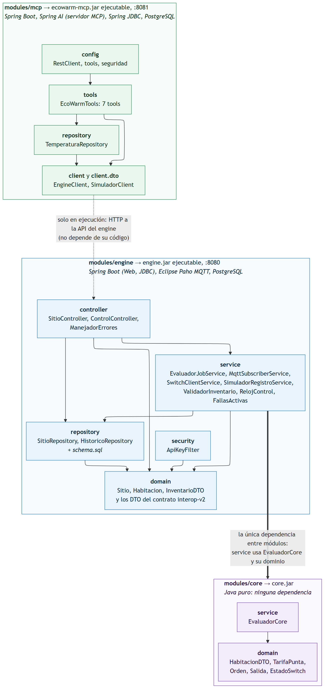
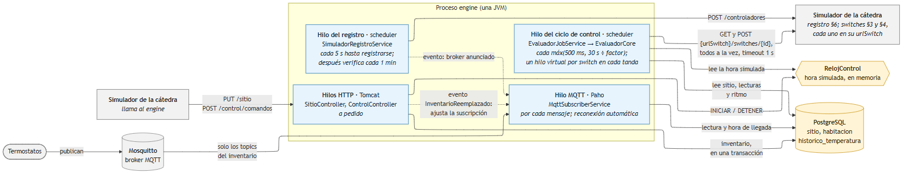
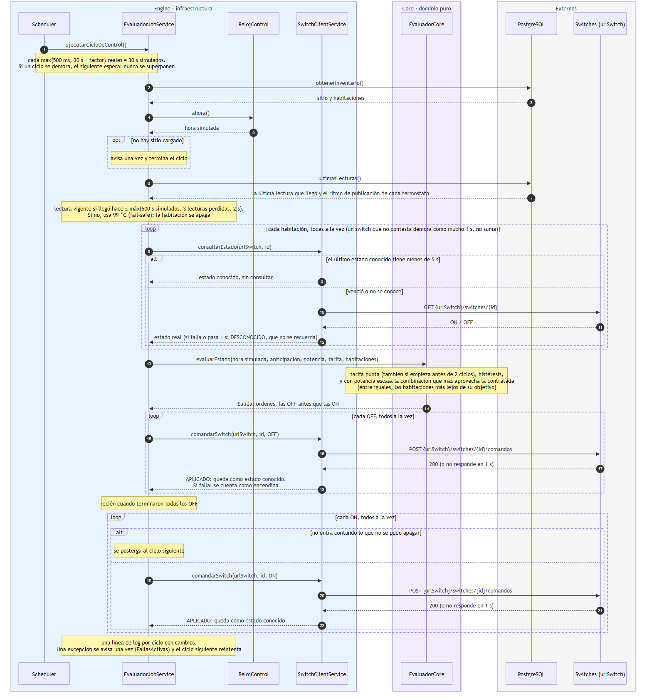
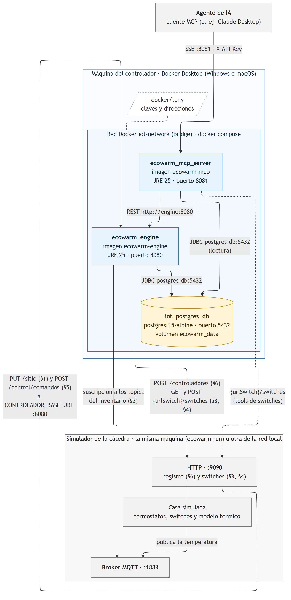

# Modelo de Arquitectura 4+1: EcoWarm 

EcoWarm es el controlador de calefacción del Grupo 3. Cada 30 segundos de tiempo simulado decide qué habitaciones calentar según su temperatura, la potencia contratada y la tarifa punta, y comanda los calefactores a través de los dispositivos del estándar `interop-v2`: termostatos que publican por MQTT y switches que se manejan por HTTP. En el curso, esos dispositivos los provee el simulador de la cátedra.

Este documento describe la arquitectura tal como quedó en la Iteración 6, con el modelo de vistas 4+1:

| Vista | Qué responde |
|---|---|
| [1. Lógica](#1-vista-lógica) | Qué componentes hay y qué hace cada uno |
| [2. Desarrollo](#2-vista-de-desarrollo) | Cómo está organizado el código y cómo se construye y se prueba |
| [3. Procesos](#3-vista-de-procesos) | Qué corre a la vez y cómo se coordina |
| [4. Física](#4-vista-física) | Dónde corre cada pieza y cómo se comunican |
| [5. Escenarios](#5-vista-de-escenarios) | Cómo colaboran las piezas en casos concretos |

El sistema tiene tres módulos Maven: `core` (las reglas de control), `engine` (el controlador) y `mcp` (un servidor MCP para que agentes de IA consulten y operen la casa). Las vistas Lógica, de Procesos y de Escenarios cubren `core` y `engine`; las de Desarrollo y Física, el sistema completo. El servidor MCP tiene su propio 4+1 en [`docs/mcp/4mas1-mcp.md`](../mcp/4mas1-mcp.md), y los contratos de las API están en [`docs/api/`](../api/). Las decisiones que dieron forma a esta arquitectura, con sus motivos y las alternativas descartadas, están en [`decisiones.md`](decisiones.md).

## 1. Vista Lógica

Esta vista cubre los dos módulos que forman el controlador, `core` y `engine`; el tercero, `mcp`, tiene su propia vista lógica en [`docs/mcp/4mas1-mcp.md`](../mcp/4mas1-mcp.md). Están separados desde la Iteración 4: así las reglas de decisión quedan aisladas de los mecanismos que se usan para obtener información, almacenar datos y ejecutar comandos sobre los dispositivos.

### A. Módulo `core` 
El módulo core contiene la lógica de negocio encargada de determinar cuándo deben encenderse o apagarse los switches asociados a las habitaciones.   

Su componente principal es EvaluadorCore, que recibe la hora de evaluación, la potencia eléctrica contratada, la configuración de la tarifa punta y una lista de habitaciones con sus temperaturas y estados actuales.  
A partir de estos datos, aplica las siguientes reglas:
  * **Tarifa punta:** ordena apagar los switches que estén encendidos durante el horario configurado, y también si la franja empieza antes de la próxima evaluación (el engine le pasa cuánto falta: dos ciclos), para que ningún calefactor quede encendido dentro de la punta.
  * **Control de temperatura:** fuera de la tarifa punta, ordena encender las habitaciones que están por debajo de la temperatura esperada y apagar las que la superan por más de 0,5 °C (histéresis, para que el relé no prenda y apague en cada ciclo).
  * **Límite de potencia:** antes de ordenar un encendido, comprueba que la potencia consumida más la requerida por la habitación no supere la potencia contratada. Con potencia escasa, enciende la combinación de habitaciones con frío que más aprovecha la potencia libre, no una por una: con 2 kW libres y habitaciones de 1,2, 0,9, 0,9 y 1,0 kW, la de 1,2 sola deja 0,8 kW donde no entra ninguna otra, mientras que la de 0,9 con la de 1,0 usan 1,9. Entre combinaciones que aprovechan lo mismo, elige la que incluye a las habitaciones más lejos de su objetivo. Si lo ya encendido no entra (porque la contratada bajó), siguen encendidas las que más la aprovechan con el mismo criterio y apaga el resto, empezando por la más cerca de su objetivo. Lo encendido no se apaga para hacerle lugar a otra: cada habitación sigue hasta superar su objetivo.
  * **Estado desconocido:** un switch en estado `DESCONOCIDO` nunca se supone apagado: se le ordena `ON` u `OFF` para dejarlo en un estado conocido.
  * **Evitar comandos innecesarios:** no genera órdenes cuando el estado actual ya satisface la condición evaluada.

El módulo utiliza objetos de dominio como HabitacionDTO, TarifaPunta, Orden y Salida para representar los datos de entrada y los resultados de la evaluación.  
La clase EvaluadorCore no necesita acceder directamente a la base de datos, comunicarse por MQTT ni realizar solicitudes HTTP. Esto permite probar las reglas de decisión de manera aislada mediante pruebas unitarias.

### B. Módulo `engine` 
El módulo engine contiene la aplicación Spring Boot y coordina la interacción entre la lógica de negocio y los componentes externos.  

Sus principales componentes son:
  * **MqttSubscriberService:** se conecta al broker MQTT y se suscribe exactamente a los `topicTermostato` que declara el inventario (sin asumir ningún formato de topic); ajusta la suscripción en cada `PUT /sitio` y en cada reconexión. Recibe los mensajes de temperatura, los deserializa y guarda las lecturas asociadas a una habitación en PostgreSQL.
  * **EvaluadorJobService:** administra la ejecución periódica del motor. Consulta la configuración del sitio, las habitaciones, las últimas temperaturas registradas y los estados de los switches. Construye los datos que necesita EvaluadorCore, ejecuta la evaluación y procesa las órdenes obtenidas.
  * **ControlController:** expone la API REST para consultar el estado del motor y enviar comandos para iniciarlo o detenerlo.
  * **SitioController:** expone la API REST para consultar y reemplazar el inventario del sitio. Valida el inventario completo (§1 de `interop-v2`) antes de persistirlo. Los switches de las habitaciones que salen no se vuelven a tocar: el controlador comanda solo los del sitio vigente.
  * **SitioRepository:** encapsula las operaciones de acceso al inventario persistido.
  * **SwitchClientService:** consulta y comanda cada switch por HTTP en el `urlSwitch` de su habitación (§3 y §4; `SWITCHES_URL` los reemplaza a todos si ese nombre no es alcanzable desde la red del engine). Recuerda el último estado conocido de cada switch durante 5 s para no consultarlo en cada ciclo.

La persistencia se realiza mediante PostgreSQL y acceso JDBC (`JdbcTemplate`). El esquema (`schema.sql`) es idempotente y se aplica en cada arranque, actualizando también bases de versiones anteriores.  
El controlador también utiliza un programador de tareas para ejecutar evaluaciones a intervalos regulares. El intervalo depende del factor de aceleración configurado, lo que permite avanzar el reloj simulado a una velocidad diferente de la real.  


## 2. Vista de Desarrollo

Cómo está organizado el código para quien lo mantiene: un proyecto Maven con tres módulos (el reactor `ioteste-domotica`), compilado con Java 25 y Spring Boot 3.5. Las flechas del diagrama son dependencias de compilación, sacadas de los `import` del código.



### Módulos y reglas de dependencia

| Módulo | Qué contiene | Depende de | Se entrega como |
|---|---|---|---|
| `core` | Las reglas de control (`EvaluadorCore`) y los datos que usan | Nada: Java puro, sin Spring, sin base y sin red | `core.jar`, una biblioteca que usa el engine |
| `engine` | El controlador: API REST (§1 y §5), registro (§6), lecturas por MQTT (§2), switches (§3 y §4), ciclo de control y persistencia | `core`, Spring Boot (Web y JDBC), Eclipse Paho, driver de PostgreSQL | `engine.jar` ejecutable, en la imagen `ecowarm-engine` (puerto 8080) |
| `mcp` | El servidor MCP para agentes de IA: 7 tools sobre el sitio, las temperaturas y los switches | Spring Boot, Spring AI (servidor MCP), Spring JDBC, driver de PostgreSQL | `ecowarm-mcp.jar` ejecutable, en la imagen `ecowarm-mcp` (puerto 8081). Su detalle está en [`docs/mcp/4mas1-mcp.md`](../mcp/4mas1-mcp.md) |

Las dependencias van en un solo sentido, sin ciclos:

* **`core` no depende de nada.** Las reglas se compilan y se prueban sin Spring, sin base y sin broker: `EvaluadorCoreTest` corre en menos de un segundo. Por eso el umbral de cobertura se exige en este módulo.
* **`engine` depende de `core`, nunca al revés.** Solo `engine.service` lo usa: arma las `HabitacionDTO`, llama a `EvaluadorCore` y ejecuta las órdenes.
* **Dentro del engine, nadie depende de `controller`.** `controller` usa `service`, `repository` y `domain`; `service` usa `repository` y `domain`; `repository` y `security` usan solo `domain`.
* **`mcp` no comparte código con los otros dos.** Habla con el engine por su API REST (el mismo contrato que el simulador) y lee la base de datos. Se compila, se prueba y se despliega por separado.

### Paquetes

| Paquete | Qué hace | Clases principales |
|---|---|---|
| `core.domain` | Entrada y salida de las reglas | `HabitacionDTO`, `TarifaPunta`, `EstadoSwitch`, `AccionSwitch`, `Orden`, `Salida` |
| `core.service` | Las reglas de control | `EvaluadorCore` |
| `engine` | Arranque de la aplicación y del programador de tareas | `EngineApplication` |
| `engine.controller` | La API REST de `controlador.openapi-v2.yaml` y el cuerpo de error uniforme | `SitioController`, `ControlController`, `ManejadorErrores` |
| `engine.security` | Exige la `X-API-Key` en la API | `ApiKeyFilter` |
| `engine.service` | El ciclo de control y todo lo que habla con el exterior | `EvaluadorJobService`, `RelojControl`, `MqttSubscriberService`, `SwitchClientService`, `SimuladorRegistroService`, `ValidadorInventario`, `FallasActivas` |
| `engine.repository` | SQL con `JdbcTemplate` y el esquema, que se aplica en cada arranque | `SitioRepository`, `HistoricoRepository`, `schema.sql` |
| `engine.domain` | Los DTO del contrato `interop-v2` y los eventos internos | `Sitio`, `Habitacion`, `InventarioDTO`, `InventarioReemplazado`, `MensajeTermostato` |

### Estructura del repositorio

```text
ioteste-domotica/
├── pom.xml                 # reactor: módulos, versiones, compilación con Java 25, Checkstyle y JaCoCo
├── google_checks.xml       # reglas de estilo (líneas de hasta 120 columnas)
├── modules/
│   ├── core/               # reglas de control, Java puro
│   ├── engine/             # el controlador (Spring Boot), con su Dockerfile
│   └── mcp/                # el servidor MCP (Spring Boot + Spring AI), con su Dockerfile
├── docker/                 # docker-compose.yml y .env (con claves: no se versiona)
├── scripts/                # construir, levantar, detener y demos
├── demo/                   # simulador de 10 habitaciones para la demo
├── docs/                   # contratos OpenAPI, arquitectura, calidad, producto y tests
└── .github/workflows/      # integración continua
```

### Build y calidad

* `mvn clean verify` desde la raíz compila los tres módulos en orden (`core` antes que `engine`), corre todos los tests y los controles de calidad. Se compila con `-parameters`, que Spring AI necesita para leer los nombres de los parámetros de las tools.
* **Checkstyle** (`google_checks.xml`, líneas de hasta 120 columnas) corre en la fase `validate`, sobre el código y también sobre los tests: una sola violación corta el build. Las convenciones del equipo están en [`docs/calidad/estandares_de_codificacion.md`](../calidad/estandares_de_codificacion.md).
* **JaCoCo** en `core`: si queda cubierto menos del 85 % de las instrucciones, el build falla en la fase `test`.

### Tests

Son 220 (37 en `core`, 151 en `engine` y 32 en `mcp`), organizados por nivel. El detalle de cada uno está en [`docs/tests/criterio-tests.md`](../tests/criterio-tests.md).

| Nivel | Dónde | Qué prueba | Necesita |
|---|---|---|---|
| Reglas | `core`: `EvaluadorCoreTest` | Cada regla y sus casos borde | Nada |
| Servicios | `engine.service` (con Mockito) | El ciclo de control, los switches, MQTT, el registro y la validación del inventario | Nada |
| API | `engine.controller`: `ApiRestTest` (`@WebMvcTest`) | La API REST contra el contrato | Nada |
| Repositorios | `engine.repository` y `mcp.repository` | El SQL contra un PostgreSQL real | Docker (Testcontainers) |
| Punta a punta | `engine.e2e`: `PuntaAPuntaTest` | El engine completo con PostgreSQL y Mosquitto reales, un simulador y termostatos falsos: 14 escenarios normales y de falla | Docker (Testcontainers) |
| MCP | `mcp` | Las tools, los clientes HTTP y el servidor | Docker para su repositorio |

Sin Docker, los tests con Testcontainers se omiten en silencio. Por eso el CI falla si se omite alguno.

### Integración continua y empaquetado

* **CI** ([`.github/workflows/maven.yml`](../../.github/workflows/maven.yml)), en cada pull request y en cada push a `main`:
  * `tests`: `mvn verify` en el runner de GitHub, que tiene Docker. Falla si se omitió algún test, y si algo falla guarda los reportes de Surefire.
  * `build-and-verify`: construye las imágenes Docker con `scripts/build.sh`.
* **Imágenes:** cada módulo Spring Boot tiene un `Dockerfile` de dos etapas. Compila con `maven:3.9-eclipse-temurin-25` (`mvn clean package -pl modules/<módulo> -am`) y corre sobre `eclipse-temurin:25-jre-alpine`. Dentro de `docker build` no hay Docker, así que ahí se omiten los tests con Testcontainers; los corre el job `tests`.
* **Configuración:** por variables de entorno en `docker/.env` (la lista está en el README). No se versiona porque tiene claves.

| Script | Qué hace |
|---|---|
| `scripts/build.sh` | Construye las imágenes (`docker compose build`) |
| `scripts/up.sh` | Construye y levanta PostgreSQL, engine y MCP |
| `scripts/stop.sh` | Detiene los contenedores sin borrarlos |
| `scripts/down.sh` | Borra contenedores, redes y volúmenes (la base incluida) |
| `scripts/tiempo-acelerado.sh` | Arranca el control en una fecha y con un factor de aceleración |
| `scripts/demo-10-habitaciones.sh` | Demo con el simulador de `demo/` (10 habitaciones), con contenedores, puertos y base propios |

## 3. Vista de Procesos

El engine es un único proceso (una JVM) con cuatro flujos que corren en paralelo. No se llaman entre sí: se coordinan a través de PostgreSQL, del reloj simulado (`RelojControl`) y de dos eventos de Spring.



| Flujo | Hilo | Cuándo corre | Qué hace |
|---|---|---|---|
| API REST | Hilos de Tomcat | A pedido del simulador | `PUT /sitio` valida el inventario, lo guarda en una sola transacción y publica el evento `InventarioReemplazado`. `POST /control/comandos` sincroniza el reloj simulado y programa o cancela el ciclo de control |
| Registro (§6) | Scheduler | Cada 5 s hasta registrarse; después verifica cada 1 min | Se presenta ante el simulador y vuelve a registrarse si el simulador se reinició. Publica el broker que anuncia el simulador |
| Recepción MQTT | Hilo de Paho | Por cada mensaje | Guarda cada lectura con la hora real en que llegó. Se suscribe a los topics del inventario al conectarse, en cada reconexión y con cada `InventarioReemplazado`. La primera conexión la reintenta un hilo propio (`mqtt-conexion`) cada 5 s; después Paho reconecta solo |
| Ciclo de control | Scheduler | Cada máx(500 ms, 30 s ÷ factor) reales, es decir, cada 30 s simulados | Ver [Ciclo de control](#ciclo-de-control) |

**Por qué los flujos no se pisan:**
* El scheduler tiene dos hilos, así que el ciclo de control y el registro nunca se bloquean entre sí.
* Un ciclo no arranca hasta que termina el anterior (`scheduleAtFixedRate`): si uno se demora más que el intervalo, el siguiente arranca tarde, nunca en paralelo.
* Dentro de un ciclo, las llamadas a los switches corren en hilos virtuales, uno por switch, y el ciclo espera a que terminen todas antes de seguir: ninguna llamada queda suelta de un ciclo a otro.
* `DETENER` cancela los ciclos siguientes, pero no el que ya está corriendo. Por eso baja primero una marca (`enEjecucion`, `volatile`) que ese ciclo mira antes de cada tanda de comandos y antes de cada comando: con el control detenido no sale ninguna orden (§5.2). Antes, un ciclo que esperaba a un switch lento mandaba su `ON` con el control ya detenido. El estado conocido de cada switch se guarda en un `ConcurrentHashMap`.
* `RelojControl` guarda la sincronización en un único objeto inmutable, publicado en un campo `volatile`: quien lo lee ve siempre un estado completo.
* La suscripción MQTT se ajusta en métodos `synchronized`, porque la pueden pedir a la vez un hilo HTTP (`PUT /sitio`) y el de Paho (una reconexión).
* El inventario se reemplaza en una transacción: el ciclo nunca ve un sitio a medio cargar.
* Una falla no corta ningún flujo. El ciclo atrapa toda excepción (si se escapara, el scheduler cancelaría las ejecuciones siguientes) y reintenta en el ciclo siguiente. Cada falla se avisa una vez al empezar y otra al recuperarse (`FallasActivas`), no en cada ciclo.

### Ciclo de control



Cada 30 segundos de tiempo lógico (`ahora = fechaHora + tiempoReal × factorTiempo`), el engine lee el sitio y la última temperatura de cada habitación, **pide el estado real de cada switch**, a todos a la vez (`GET {urlSwitch}/switches/{id}`, la única fuente de verdad: el switch también puede accionarse desde el MCP o la consola del simulador), le pasa todo al `EvaluadorCore` y envía las órdenes resultantes. Para no consultar a cada switch en cada ciclo (a ×60 serían dos consultas por segundo), `SwitchClientService` recuerda el último estado conocido durante 5 s reales: un comando aplicado lo actualiza sin consultar, y una falla o un estado `DESCONOCIDO` obligan a releerlo en el ciclo siguiente. Al iniciar el control se relee el estado de todos. Un switch que no se pudo consultar o que el simulador informa como `DESCONOCIDO` se comanda explícitamente para dejarlo en un estado conocido. Salvo que el último estado conocido fuera `ON`: una consulta fallida no cambia el switch, así que se lo sigue contando encendido y no se lo apaga para darle su lugar a otra habitación (con 50 switches por Wi-Fi, un error de conexión ocasional provocaba rotaciones de más).

Además, en cada ciclo:
* **La última lectura es la que llegó última**, no la de hora simulada mayor: cada `INICIAR` puede volver el reloj simulado atrás, y las lecturas de una corrida anterior taparían a las nuevas.
* **Un mensaje fuera del contrato (§2) no es una lectura.** `MqttSubscriberService` descarta el mensaje que no es un objeto JSON, el que no trae `tC`, el que trae `tC` como texto (`"20.0"`) y el que trae una temperatura fuera del rango plausible de una habitación, de −10 a 50 °C: −40 °C y 85 °C son valores de error de los sensores. El termostato queda como si estuviera callado, así que el fail-safe apaga su habitación. Se avisa una vez cuando empieza a mandar mal y otra cuando se recupera.
* **Una lectura vieja no se usa.** La lectura de un termostato vale mientras no hayan pasado 600 s simulados o 3 lecturas perdidas, lo que sea mayor, con un piso de 2 s. El ritmo de cada termostato se mide con sus últimas lecturas. Si la lectura venció, el engine usa 99 °C (fail-safe) y la habitación se apaga.
* **Las órdenes `OFF` van antes que las `ON`**, para liberar potencia antes de volver a ocuparla: primero salen todos los `OFF`, a la vez, y recién cuando terminan, todos los `ON`. Si un `OFF` falla, esa habitación se cuenta como encendida: un `ON` que con ella no entra en la contratada se posterga al ciclo siguiente.
* **Un switch que no contesta no frena el control.** Cada llamada espera como mucho 3 s para conectar (en Wi-Fi, un paquete de conexión perdido se reintenta recién al segundo) y 1 s para la respuesta (un switch colgado, como en F05, acepta la conexión y no contesta); después se da por fallada y se reintenta en el ciclo siguiente. Como las llamadas de cada tanda van a la vez, un ciclo con switches colgados se demora a lo sumo un timeout por tanda (consultas, `OFF`, `ON`), no uno por switch. Antes, de a una y con 2 s, diez switches colgados dejaban el control sin evaluar 40 s reales: 40 minutos simulados con ×60.

Las fuentes de los diagramas de esta vista están en [`diagramas/`](diagramas/).

## 4. Vista Física

Dónde corre cada pieza y cómo se comunican. El controlador se despliega con Docker Compose en una sola máquina: tres contenedores en una red `bridge`. Del otro lado está el simulador de la cátedra, que hace de casa (termostatos, switches y broker MQTT); puede correr en la misma máquina, con `ecowarm-run`, o en otra de la red local, como en las pruebas de la clase.



### Nodos

| Nodo | Qué corre | Imagen o requisito | Puerto |
|---|---|---|---|
| `iot_postgres_db` | PostgreSQL 15: sitio, habitaciones e histórico de temperaturas | `postgres:15-alpine`, con los datos en el volumen `ecowarm_data` | 5432 |
| `ecowarm_engine` | El controlador | `ecowarm-engine` (JRE 25 sobre Alpine) | 8080 |
| `ecowarm_mcp_server` | El servidor MCP para agentes de IA | `ecowarm-mcp` (JRE 25 sobre Alpine) | 8081 |
| Simulador de la cátedra | HTTP para el registro y los switches, broker MQTT y la casa simulada | `ecowarm-run.jar` (Java 21 o más) o el simulador del profesor | 9090 (HTTP) y 1883 (MQTT) por defecto |
| Agente de IA | Un cliente MCP, por ejemplo Claude Desktop | — | Se conecta al 8081 |

La máquina del controlador solo necesita Docker Desktop con Compose; Java hace falta únicamente para correr `ecowarm-run`. Como referencia de consumo: controlando 50 habitaciones a ×60, el engine usó unos 180 MB de memoria y 6 % de CPU.

### Comunicaciones

| De → a | Protocolo | Para qué | Dirección |
|---|---|---|---|
| Simulador → engine | HTTP, con la `X-API-Key` del engine | Cargar el sitio (`PUT /sitio`, §1) e iniciar o detener el control (`POST /control/comandos`, §5) | `CONTROLADOR_BASE_URL`, que el engine declara al registrarse |
| Engine → simulador | HTTP, con la `X-API-Key` del simulador | Registrarse (§6): cada 5 s hasta lograrlo y después cada minuto, para volver a registrarse si el simulador se reinició | `SIMULADOR_URL` |
| Engine → switches | HTTP | Consultar y comandar cada switch (§3 y §4) | El `urlSwitch` de cada habitación (o `SWITCHES_URL`) |
| Engine → broker | MQTT | Recibir las lecturas de los topics del inventario (§2) | El broker que anuncia el simulador (o `MQTT_BROKER_URL`) |
| Engine y MCP → PostgreSQL | JDBC | Guardar y leer el sitio y las lecturas (el MCP solo lee) | `DB_URL`: `postgres-db:5432` dentro de la red Docker |
| MCP → engine | HTTP | Leer el sitio (`GET /sitio`) y consultar, iniciar o detener el control | `ENGINE_URL`: `http://engine:8080` |
| Agente → MCP | HTTP con SSE, con la `X-API-Key` del MCP si se definió | Usar las tools | `http://<máquina>:8081/mcp/sse` |

### Arranque

* Compose levanta primero la base. El engine arranca recién cuando PostgreSQL está sano (`pg_isready`, cada 10 s) y el MCP después del engine.
* El engine aplica `schema.sql` al arrancar: crea las tablas o actualiza las de una versión anterior, sin pasos manuales.
* El orden respecto del simulador no importa: el engine reintenta el registro y la conexión al broker cada 5 s, y `ecowarm-run` espera hasta 5 minutos a que el controlador se registre.

### Tres maneras de desplegarlo

| Situación | Dónde está el simulador | Configuración en `docker/.env` |
|---|---|---|
| Pruebas con `ecowarm-run` | En la misma máquina, fuera de Docker | `SIMULADOR_URL=http://host.docker.internal:9090`. El runner se corre con `--host host.docker.internal` para que los `urlSwitch` y el broker que anuncia apunten a la máquina. `CONTROLADOR_BASE_URL` queda en su valor por defecto (`http://localhost:8080`) |
| Simulador en otra máquina de la red local (la clase) | En la máquina del profesor | `SIMULADOR_URL` y `MQTT_BROKER_URL` con la IP y los puertos de esa máquina, y `CONTROLADOR_BASE_URL=http://<IP de esta máquina>:8080`, porque `localhost` para el simulador es su propia máquina. Las dos tienen que estar en la misma red; Docker Desktop instala una regla de firewall que deja entrar al 8080 incluso en una red Wi-Fi pública |
| Demo de 10 habitaciones (`scripts/demo-10-habitaciones.sh`) | En un contenedor más | Todo dentro de Docker, en un proyecto Compose aparte (`ecowarm-demo`) con contenedores, base y puertos propios (28080, 28081, 25432 y 29090): no toca el stack real |

### Datos y seguridad

* Los datos viven en el volumen `ecowarm_data`: `scripts/stop.sh` los conserva y `scripts/down.sh` los borra.
* Las claves están en `docker/.env`, que no se versiona. El engine exige `APP_API_KEY` en su API y se la declara al simulador al registrarse; con el simulador usa `SIMULADOR_API_KEY`. El MCP exige `MCP_API_KEY` solo si se define: sin ella queda abierto.
* PostgreSQL publica el 5432 en la máquina para poder inspeccionar la base. En una red compartida queda expuesto, protegido solo por su contraseña.

### Limitaciones del despliegue

* **Linux:** el `docker-compose.yml` no declara `host.docker.internal`. Docker Desktop (Windows y macOS) lo resuelve solo; con Docker Engine en Linux hay que usar la IP de la máquina o agregar `extra_hosts: ["host.docker.internal:host-gateway"]` al engine y al MCP.
* **Una sola instancia:** un engine por sitio. El reloj simulado, el estado conocido de los switches y el ciclo de control viven en memoria, así que no se puede replicar.
* **Reinicio:** si el engine se reinicia, el sitio se conserva en la base, pero el control queda detenido hasta el próximo `INICIAR` del simulador.

## 5. Vista de Escenarios

### Escenario: ejecución acelerada del controlador

**Objetivo:** permitir que el sistema simule el paso del tiempo a una velocidad superior a la real, facilitando la evaluación de las reglas de control en distintos horarios.

- El administrador envía un comando `INICIAR` mediante `POST /control/comandos`, incluyendo la fecha y hora inicial y el factor de aceleración.
- `ControlController` valida que se haya proporcionado la fecha y hora, actualiza el estado del control e invoca `EvaluadorJobService.iniciarMotor`.
- `EvaluadorJobService` configura el reloj simulado y programa la ejecución periódica del ciclo de control.
- En cada ciclo, el servicio consulta los datos necesarios y utiliza la hora simulada para invocar las reglas de negocio de `EvaluadorCore`.
- El Core devuelve las órdenes de control correspondientes y el motor intenta ejecutarlas mediante `SwitchClientService`.
- El administrador puede detener el controlador enviando el comando `DETENER`.

**Resultado:** el sistema puede evaluar situaciones correspondientes a distintos momentos del tiempo simulado sin esperar a que transcurra todo ese tiempo en la realidad. Por ejemplo, con un factor de aceleración de `60x`, el motor programa ciclos cada 500 milisegundos reales, equivalentes aproximadamente a 30 segundos simulados por ciclo, siempre que la ejecución no supere ese intervalo.


### Escenario: pérdida o desactualización de la lectura del termostato

**Objetivo:** evitar que el controlador tome decisiones de calefacción basándose en lecturas que considera demasiado antiguas.

- El motor inicia un ciclo de evaluación y consulta la última lectura de temperatura registrada para cada habitación.
- Si no existe una lectura, o el termostato no publica desde hace más de 600 segundos simulados (o, si eso es más, desde hace 3 lecturas perdidas: el engine mide cada cuánto publica cada termostato con la mediana de los huecos entre sus últimas 5 lecturas, así que con aceleración alta no da por vencidas lecturas que todavía no les tocaba llegar), `EvaluadorJobService` utiliza el valor de respaldo `99.0 °C` como temperatura actual.
- El servicio construye el `HabitacionDTO` con los datos de la habitación y lo entrega a `EvaluadorCore`.
- El Core compara la temperatura actual recibida con la temperatura esperada y aplica sus reglas de control.
- Fuera del horario de tarifa punta, si el switch está encendido y la temperatura de respaldo supera la esperada, el Core genera una orden `OFF`.
- `EvaluadorJobService` intenta ejecutar la orden mediante `SwitchClientService`, que se comunica con el simulador de switches por HTTP.

**Resultado:** una lectura ausente o desactualizada puede provocar el apagado de la calefacción cuando estaba encendida. El valor de `99.0 °C` es un mecanismo de respaldo de la implementación actual; no representa una medición real ni garantiza que el termostato se haya desconectado.


---
