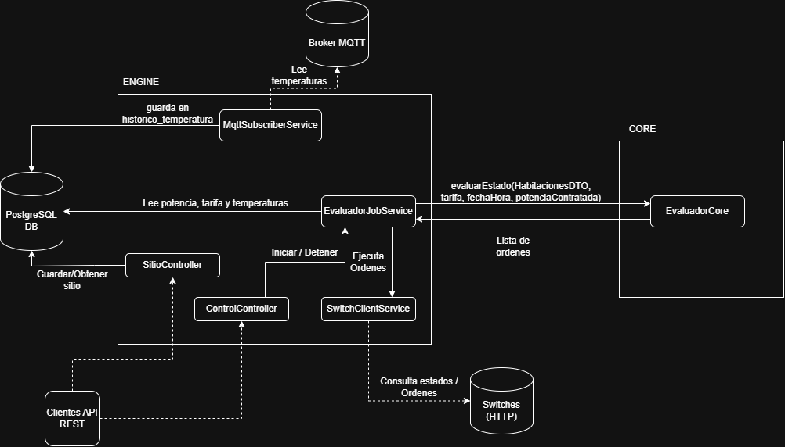
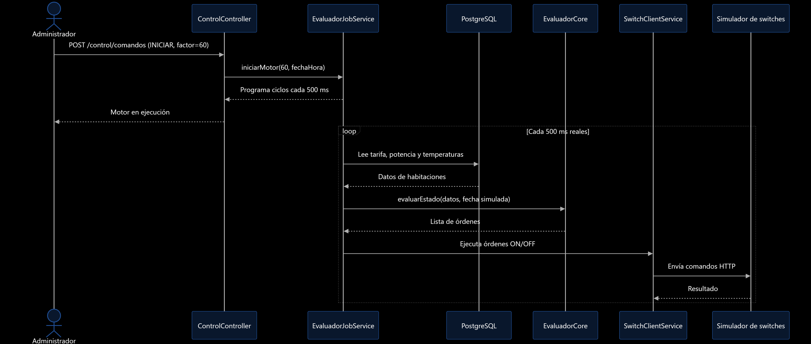
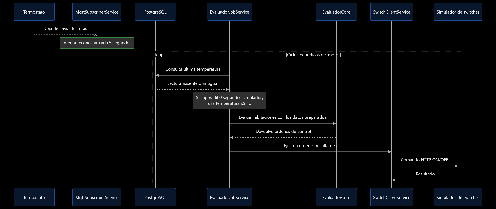

# Modelo de Arquitectura 4+1: EcoWarm 

Este documento describe la arquitectura del sistema EcoWarm basándose en el modelo de vistas 4+1, haciendo especial énfasis en la **Vista Lógica** y en la separación estructural implementada en la Iteración 4.

## 1. Vista Lógica

La arquitectura lógica de EcoWarm se organiza en dos módulos Maven: core y engine. Esta separación permite mantener las reglas de decisión del sistema aisladas de los mecanismos utilizados para obtener información, almacenar datos y ejecutar comandos sobre los dispositivos.

### A. Módulo `core` 
El módulo core contiene la lógica de negocio encargada de determinar cuándo deben encenderse o apagarse los switches asociados a las habitaciones.   

Su componente principal es EvaluadorCore, que recibe la hora de evaluación, la potencia eléctrica contratada, la configuración de la tarifa punta y una lista de habitaciones con sus temperaturas y estados actuales.  
A partir de estos datos, aplica las siguientes reglas:
  * **Tarifa punta:** ordena apagar los switches que estén encendidos durante el horario configurado.
  * **Control de temperatura:** fuera de la tarifa punta, ordena apagar las habitaciones que alcanzaron la temperatura esperada y encender las que necesitan calor.
  * **Límite de potencia:** antes de ordenar un encendido, comprueba que la potencia consumida más la requerida por la habitación no supere la potencia contratada.
  * **Evitar comandos innecesarios:** no genera órdenes cuando el estado actual ya satisface la condición evaluada.

El módulo utiliza objetos de dominio como HabitacionDTO, TarifaPunta, Orden y Salida para representar los datos de entrada y los resultados de la evaluación.  
La clase EvaluadorCore no necesita acceder directamente a la base de datos, comunicarse por MQTT ni realizar solicitudes HTTP. Esto permite probar las reglas de decisión de manera aislada mediante pruebas unitarias.

### B. Módulo `engine` 
El módulo engine contiene la aplicación Spring Boot y coordina la interacción entre la lógica de negocio y los componentes externos.  

Sus principales componentes son:
  * **MqttSubscriberService:** se conecta al broker MQTT, recibe mensajes de temperatura, los deserializa y guarda las lecturas asociadas a una habitación en PostgreSQL.
  * **EvaluadorJobService:** administra la ejecución periódica del motor. Consulta la configuración del sitio, las habitaciones, las últimas temperaturas registradas y los estados de los switches. Construye los datos que necesita EvaluadorCore, ejecuta la evaluación y procesa las órdenes obtenidas.
  * **ControlController:** expone la API REST para consultar el estado del motor y enviar comandos para iniciarlo o detenerlo.
  * **SitioController:** expone la API REST para consultar y reemplazar el inventario del sitio, validando la versión del esquema recibida.
  * **SitioRepository:** encapsula las operaciones de acceso al inventario persistido.
  * **SwitchClientService:** participa en la ejecución de las órdenes mediante solicitudes HTTP al simulador de switches.

La persistencia se realiza mediante PostgreSQL y acceso JDBC a través de DataSource en los componentes mostrados.  
El controlador también utiliza un programador de tareas para ejecutar evaluaciones a intervalos regulares. El intervalo depende del factor de aceleración configurado, lo que permite avanzar el reloj simulado a una velocidad diferente de la real.  

## 5. Vista de Escenarios

### Escenario: ejecución acelerada del controlador

**Objetivo:** permitir que el sistema simule el paso del tiempo a una velocidad superior a la real, facilitando la evaluación de las reglas de control en distintos horarios.

- El administrador envía un comando `INICIAR` mediante `POST /control/comandos`, incluyendo la fecha y hora inicial y el factor de aceleración.
- `ControlController` valida que se haya proporcionado la fecha y hora, actualiza el estado del control e invoca `EvaluadorJobService.iniciarMotor`.
- `EvaluadorJobService` configura el reloj simulado y programa la ejecución periódica del ciclo de control.
- En cada ciclo, el servicio consulta los datos necesarios y utiliza la hora simulada para invocar las reglas de negocio de `EvaluadorCore`.
- El Core devuelve las órdenes de control correspondientes y el motor intenta ejecutarlas mediante `SwitchClientService`.
- El administrador puede detener el controlador enviando el comando `DETENER`.

**Resultado:** el sistema puede evaluar situaciones correspondientes a distintos momentos del tiempo simulado sin esperar a que transcurra todo ese tiempo en la realidad. Por ejemplo, con un factor de aceleración de `60x`, el motor programa ciclos cada 500 milisegundos reales, equivalentes aproximadamente a 30 segundos simulados por ciclo, siempre que la ejecución no supere ese intervalo.

### Escenario: pérdida o desactualización de la lectura del termostato

**Objetivo:** evitar que el controlador tome decisiones de calefacción basándose en lecturas que considera demasiado antiguas.

- El motor inicia un ciclo de evaluación y consulta la última lectura de temperatura registrada para cada habitación.
- Si no existe una lectura o su antigüedad supera los 600 segundos simulados, `EvaluadorJobService` utiliza el valor de respaldo `99.0 °C` como temperatura actual.
- El servicio construye el `HabitacionDTO` con los datos de la habitación y lo entrega a `EvaluadorCore`.
- El Core compara la temperatura actual recibida con la temperatura esperada y aplica sus reglas de control.
- Fuera del horario de tarifa punta, si el switch está encendido y la temperatura de respaldo supera la esperada, el Core genera una orden `OFF`.
- `EvaluadorJobService` intenta ejecutar la orden mediante `SwitchClientService`, que se comunica con el simulador de switches por HTTP.

**Resultado:** una lectura ausente o desactualizada puede provocar el apagado de la calefacción cuando estaba encendida. El valor de `99.0 °C` es un mecanismo de respaldo de la implementación actual; no representa una medición real ni garantiza que el termostato se haya desconectado.

---