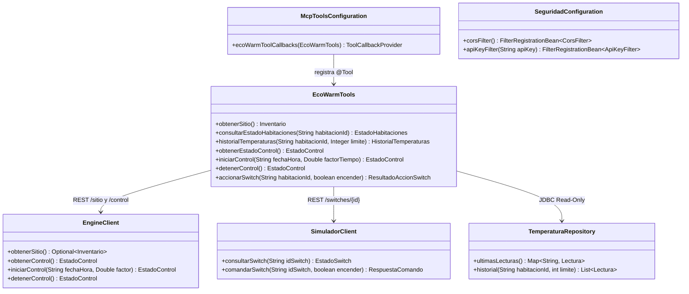
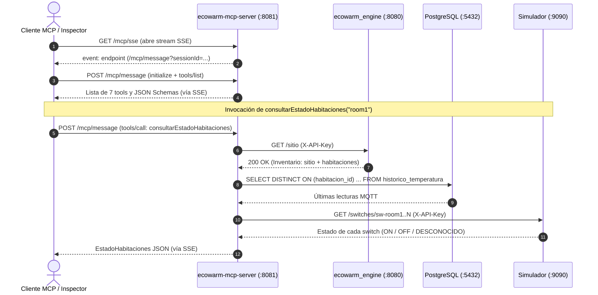
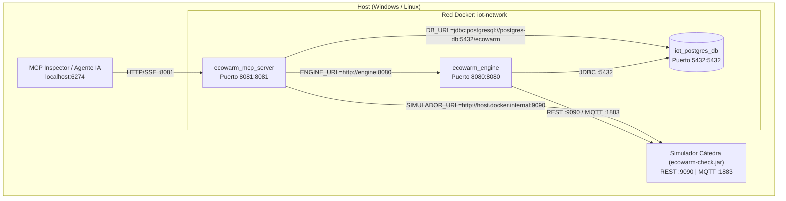

# Modelo de Arquitectura 4+1: Módulo MCP (`ecowarm-mcp-server`)

**Proyecto:** Controlador Domótico IoTEste EcoWarm — Grupo 3  
**Módulo:** `modules/mcp`  
**Stack:** Java 25 · Spring Boot 3.5 · Spring AI 1.0 (`spring-ai-starter-mcp-server-webmvc`)

Este documento describe la arquitectura del servidor **Model Context Protocol (MCP)** de EcoWarm siguiendo el modelo de **Vistas 4+1 de Kruchten** (Vista Lógica, Vista de Desarrollo, Vista de Procesos, Vista Física/Despliegue y Vista de Escenarios/+1).

---

## 1. Vista Lógica (Logical View)

La Vista Lógica descompone el módulo `mcp` en sus responsabilidades funcionales y muestra cómo expone el dominio de EcoWarm a agentes de IA manteniendo **cero acoplamiento** con el código interno del `engine`.

### Principios de Diseño
* **Desacoplamiento por contrato:** El módulo `mcp` no importa el JAR de `engine`; se comunica únicamente a través de los contratos OpenAPI v2 (`controlador.openapi-v2.yaml` y `simulador.openapi-v2.yaml`).
* **Segregación de lectura/operación (CQRS liviano):** Las operaciones de control e inventario pasan por la API REST del `engine`, los actuadores se consultan/comandan en el simulador, y las series temporales de temperatura se leen directamente desde PostgreSQL mediante un pool de conexiones **estrictamente de solo lectura (`read-only=true`)**.
* **Tolerancia a fallos degradada:** Si la base de datos o un switch puntual no responde durante una consulta global, la tool no colapsa; reporta `NO_DISPONIBLE` y agrega el detalle en la lista `advertencias` para que el agente de IA pueda razonar sobre el fallo.



---

## 2. Vista de Desarrollo / Implementación (Development View)

El módulo vive en `modules/mcp` como tercer submódulo del reactor Maven raíz (`ioteste-domotica`) y se organiza por capas claras:

```text
modules/mcp/
├── Dockerfile
├── pom.xml
└── src/
    ├── main/
    │   ├── java/com/ioteste/mcp/
    │   │   ├── EcoWarmMcpApplication.java          # Entrypoint Spring Boot
    │   │   ├── client/
    │   │   │   ├── EngineClient.java               # Cliente REST hacia ecowarm_engine (:8080)
    │   │   │   ├── SimuladorClient.java            # Cliente REST hacia el Simulador (:9090)
    │   │   │   ├── ServicioExternoException.java   # Excepción semántica para el agente IA
    │   │   │   └── dto/
    │   │   │       ├── EngineDtos.java             # Records de controlador.openapi-v2.yaml
    │   │   │       └── SimuladorDtos.java          # Records de simulador.openapi-v2.yaml
    │   │   ├── config/
    │   │   │   ├── HttpClientsConfiguration.java   # RestClient con timeouts (2s connect / 5s read)
    │   │   │   ├── McpToolsConfiguration.java      # MethodToolCallbackProvider (Spring AI)
    │   │   │   └── SeguridadConfiguration.java     # CORS (Mcp-Session-Id) + X-API-Key
    │   │   ├── repository/
    │   │   │   └── TemperaturaRepository.java      # Consultas SQL sobre historico_temperatura
    │   │   └── tools/
    │   │       ├── EcoWarmTools.java               # Las 7 tools anotadas con @Tool y @ToolParam
    │   │       └── ToolDtos.java                   # Records inmutables de respuesta MCP
    │   └── resources/
    │       └── application.properties              # Configuración SSE (/mcp/sse, /mcp/message)
    └── test/
        └── java/com/ioteste/mcp/
            ├── McpServerContextTest.java           # Test de integración del servidor MCP y seguridad
            ├── client/ClientesHttpTest.java        # Tests con MockRestServiceServer
            └── tools/EcoWarmToolsTest.java         # Tests unitarios de las 7 tools
```

* **Generación de esquemas JSON:** El `pom.xml` compila con `<maven.compiler.parameters>true</maven.compiler.parameters>`, permitiendo que Spring AI inspeccione por reflexión los nombres reales de los parámetros (`habitacionId`, `encender`, `limite`, `fechaHora`, `factorTiempo`) y sus descripciones `@ToolParam`.

---

## 3. Vista de Procesos (Process View)

Describe la concurrencia, el protocolo de sesión SSE de MCP y el flujo sincrónico con timeouts acotados para evitar bloquear al agente de IA.



* **Timeouts de red:** Todos los `RestClient` hacia `engine` y `simulador` tienen `connectTimeout = 2000 ms` y `readTimeout = 5000 ms`, y el pool HikariCP tiene `connection-timeout = 3000 ms` con `maximum-pool-size = 3`.

---

## 4. Vista Física / de Despliegue (Physical View)

El servidor MCP se despliega como un contenedor Docker independiente (`ecowarm_mcp_server`) dentro de la red bridge `iot-network`, construido con un `Dockerfile` multi-etapa (`maven:3.9-eclipse-temurin-25` -> `eclipse-temurin:25-jre-alpine`).



---

## 5. Vista de Escenarios (+1 / Scenarios)

### Escenario 1: Diagnóstico térmico y energético de la vivienda
1. El operador o agente IA invoca `consultarEstadoHabitaciones`.
2. El servidor MCP obtiene el inventario desde `engine`, cruza con la última temperatura MQTT en PostgreSQL y el estado de cada switch en el simulador, y responde cuánta potencia está en uso (`potenciaEnUsoKW`), cuánta queda libre (`potenciaDisponibleKW`) y qué habitaciones necesitan calor.

### Escenario 2: Intervención manual sobre una habitación y verificación de calentamiento
1. El agente IA invoca `accionarSwitch(habitacionId="room2", encender=true)`.
2. `SimuladorClient` envía `POST /switches/sw-room2/comandos` con `{"accion":"ON"}` al simulador.
3. `EngineClient` verifica si el motor automático está `EN_EJECUCION` y anexa una advertencia preventiva en la respuesta si corresponde.
4. Minutos después, el agente invoca `historialTemperaturas(habitacionId="room2", limite=10)` y comprueba en la serie histórica que la temperatura de la habitación está subiendo.

> La evidencia completa con capturas reales de estos escenarios se encuentra en [`docs/mcp/pruebas-mcp.md`](./pruebas-mcp.md).

