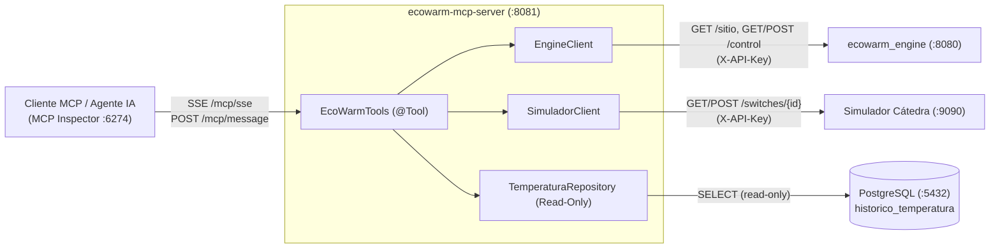
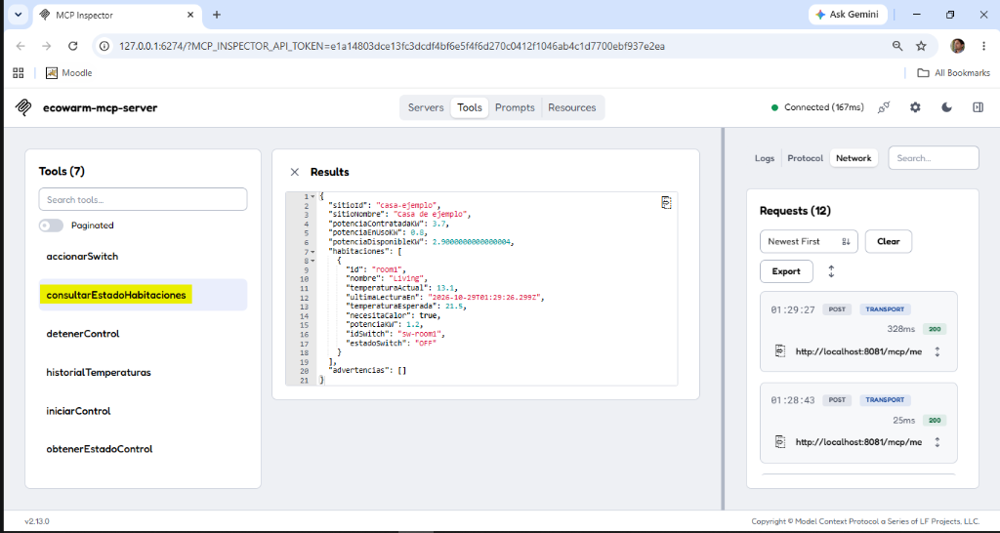
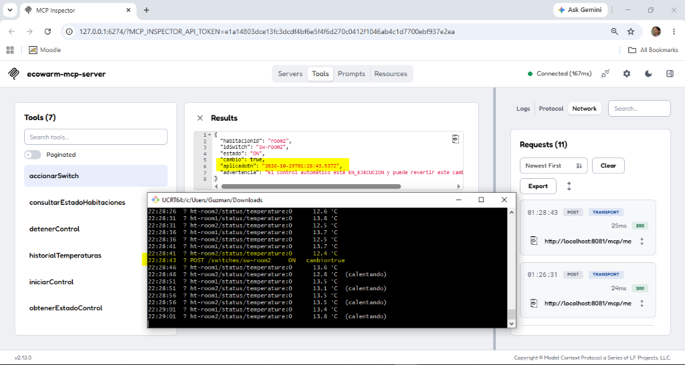
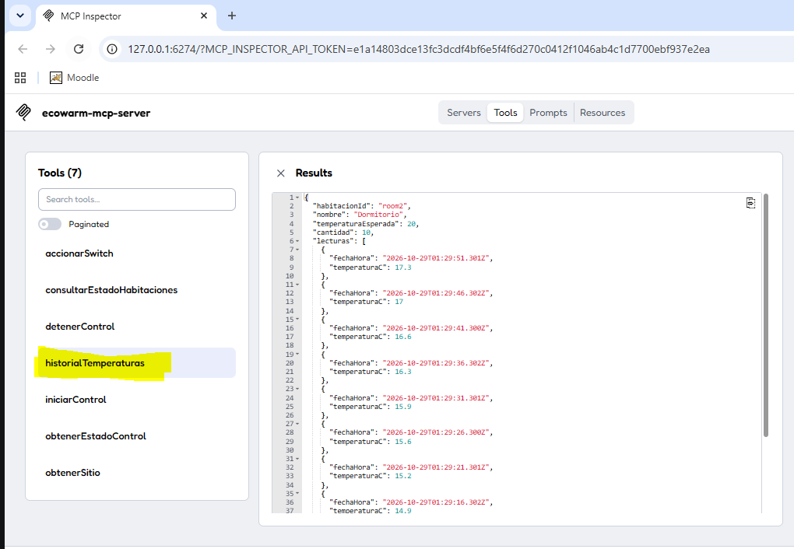

# Servidor MCP (Model Context Protocol) — EcoWarm

**Proyecto:** Controlador Domótico IoTEste EcoWarm — Grupo 3  
**Módulo:** `modules/mcp` (`ecowarm-mcp-server`)  
**Puerto y transporte:** HTTP + SSE en `:8081` (`/mcp/sse` y `/mcp/message`)

---

## 1. Propósito y Arquitectura del Módulo MCP

El módulo **`mcp`** incorpora un servidor **Model Context Protocol (MCP)** construido con **Spring AI 1.0** (`spring-ai-starter-mcp-server-webmvc`) sobre **Java 25** y **Spring Boot 3.5**. Su objetivo es exponer las capacidades de monitoreo y operación del sistema **EcoWarm** como herramientas (*tools*) tipadas para que cualquier agente de IA o cliente compatible con MCP (como **MCP Inspector**, Claude Desktop o IDEs con soporte MCP) pueda consultar el estado térmico/eléctrico del hogar y operar el controlador en tiempo real.

Para mantener el desacoplamiento arquitectónico del proyecto, el servidor MCP implementa una **arquitectura híbrida sin acoplarse al JAR del `engine`**:

1. **Cliente REST del Engine (`EngineClient`):** consume los endpoints oficiales del controlador (`GET /sitio`, `GET /control`, `POST /control/comandos`) autenticándose mediante el header `X-API-Key`.
2. **Cliente REST del Simulador (`SimuladorClient`):** consulta el estado en vivo de cada relé (`GET /switches/{idSwitch}`) y ejecuta órdenes manuales de encendido/apagado (`POST /switches/{idSwitch}/comandos`).
3. **Repositorio JDBC de Solo Lectura (`TemperaturaRepository`):** consulta la tabla `historico_temperatura` en PostgreSQL con conexión configurada en modo `read-only=true` para obtener la última temperatura reportada por MQTT y la serie histórica de cada habitación.

---

## 2. Catálogo de Tools Expuestas (7 Tools)

El servidor registra automáticamente las siguientes 7 herramientas mediante `MethodToolCallbackProvider`:

| Tool | Parámetros | Descripción |
|---|---|---|
| `obtenerSitio` | *(ninguno)* | Devuelve el inventario cargado en el controlador: datos del sitio, potencia contratada (kW), franja de tarifa punta y listado de habitaciones con sus sensores y switches. |
| `consultarEstadoHabitaciones` | `habitacionId` *(opcional)* | Combina el inventario, la última lectura MQTT en BD y el estado de cada switch en el simulador. Calcula `potenciaContratadaKW`, `potenciaEnUsoKW`, `potenciaDisponibleKW` y si cada habitación `necesitaCalor`. |
| `historialTemperaturas` | `habitacionId` *(req)*, `limite` *(opc, 1–500, def: 20)* | Devuelve las últimas $N$ lecturas registradas por el termostato de la habitación, ordenadas de la más reciente a la más antigua. |
| `obtenerEstadoControl` | *(ninguno)* | Consulta en el `engine` el estado del motor automático (`EN_EJECUCION` o `DETENIDO`), el instante lógico (`fechaHora`), el `factorTiempo` y `iniciadoEn`. |
| `iniciarControl` | `fechaHora` *(req, ISO-8601)*, `factorTiempo` *(opc, >0)* | Inicia o re-sincroniza el ciclo automático del controlador validando previamente el formato ISO-8601 y el factor de aceleración. |
| `detenerControl` | *(ninguno)* | Detiene de forma idempotente el ciclo automático de evaluación en el `engine`. |
| `accionarSwitch` | `habitacionId` *(req)*, `encender` *(req, boolean)* | Enciende (`ON`) o apaga (`OFF`) manualmente el switch asociado a una habitación en el simulador e informa si el estado cambió (`cambio: true/false`) junto con una advertencia si el control automático está activo. |

---

## 3. Evidencia de Pruebas E2E con el Simulador y MCP Inspector

Las siguientes pruebas fueron ejecutadas levantando la infraestructura completa en Docker (`postgres-db`, `ecowarm_engine` y `ecowarm_mcp_server`), el verificador/simulador oficial de la cátedra (`ecowarm-check.jar`) y el cliente interactivo **MCP Inspector v2.13.0** conectado por SSE a `http://localhost:8081/mcp/sse`.

---

### 3.1 Prueba 1: Consulta de Estado Integral (`consultarEstadoHabitaciones`)

Se invocó la tool `consultarEstadoHabitaciones` filtrando por la habitación `room1` (*Living*).

- **Resultado verificado:**
  - El servidor MCP consultó el sitio `casa-ejemplo` (*Casa de ejemplo*) con una potencia contratada de `3.7 kW`.
  - Calculó correctamente la potencia total en uso de la vivienda (`0.8 kW` tomados por otra habitación encendida) y la potencia disponible restante (`2.9 kW`).
  - Recuperó desde PostgreSQL la última lectura MQTT de `room1` (`13.1 °C` a las `2026-10-29T01:29:26.299Z`), la comparó contra la temperatura esperada (`21.5 °C`), determinó `necesitaCalor: true`, consultó el estado del switch `sw-room1` (`OFF`) y retornó `advertencias: []` (sin errores de conectividad).

---

### 3.2 Prueba 2: Accionamiento Manual de un Switch (`accionarSwitch`) e Impacto en el Simulador

Se invocó la tool `accionarSwitch` sobre la habitación `room2` (*Dormitorio*) con `encender: true`.

- **Resultado verificado en MCP Inspector y en la consola del Simulador:**
  1. El servidor MCP resolvió el switch `sw-room2` correspondiente a `room2` y envió `POST /switches/sw-room2/comandos` con `{"accion": "ON"}`.
  2. La consola del simulador (`ecowarm-check.jar`) registró en el instante `22:28:43` la petición `POST /switches/sw-room2 ON cambio=true`, y a partir de la siguiente lectura MQTT (`22:28:46`) la habitación pasó al estado **`(calentando)`**, subiendo su temperatura progresivamente de `12.4 °C` -> `12.8 °C` -> `13.1 °C` -> `13.5 °C` -> `13.8 °C`.
  3. La respuesta JSON del MCP incluyó además la advertencia preventiva indicando que el motor automático se encuentra `EN_EJECUCION`.

---

### 3.3 Prueba 3: Serie Histórica de Temperaturas (`historialTemperaturas`)

Luego de encender la calefacción de `room2`, se invocó la tool `historialTemperaturas` para `habitacionId: "room2"` con `limite: 10`.

- **Resultado verificado:**
  - El servidor MCP devolvió las últimas 10 lecturas almacenadas en `historico_temperatura` en orden cronológico inverso (cada 5 segundos reales), evidenciando la curva de calentamiento real de la habitación desde `14.9 °C` (`01:29:16Z`) hasta `17.3 °C` (`01:29:51Z`) rumbo a la temperatura objetivo de `20.0 °C`.

---

## 4. Pruebas Automatizadas del Módulo (`mvn test -pl modules/mcp`)

Además de la verificación E2E con MCP Inspector, el módulo cuenta con una suite de **22 pruebas automatizadas** en JUnit 5 y AssertJ/Mockito que se ejecutan en el pipeline de Maven:

- **`EcoWarmToolsTest` (12 tests):** valida todas las reglas de las 7 tools, el cálculo de potencia disponible en toda la casa, la tolerancia a fallos parciales (caída de BD o del simulador reportada en `advertencias`), la validación de parámetros (`fechaHora` ISO-8601, `factorTiempo > 0`, rangos de `limite`) y la advertencia cuando se acciona un switch con el control automático en ejecución.
- **`ClientesHttpTest` (7 tests):** verifica con `MockRestServiceServer` la serialización/deserialización JSON, el envío del header `X-API-Key` y la traducción de códigos HTTP (`401`, `404`) a mensajes claros para el agente.
- **`McpServerContextTest` (3 tests):** levanta el contexto completo de Spring Boot, comprueba que las 7 tools queden registradas en el `ToolCallbackProvider` con sus esquemas JSON de entrada y verifica que el filtro de seguridad rechace con `401 Unauthorized` las peticiones sin `X-API-Key` cuando `MCP_API_KEY` está configurada.

